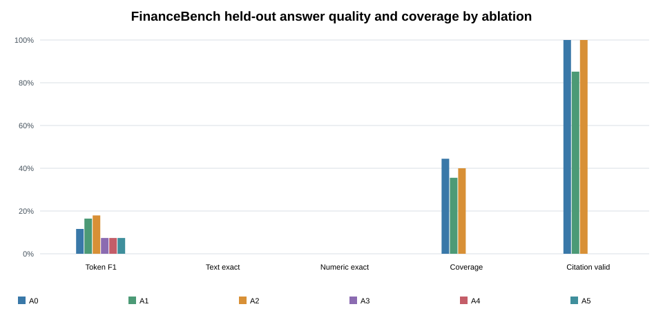
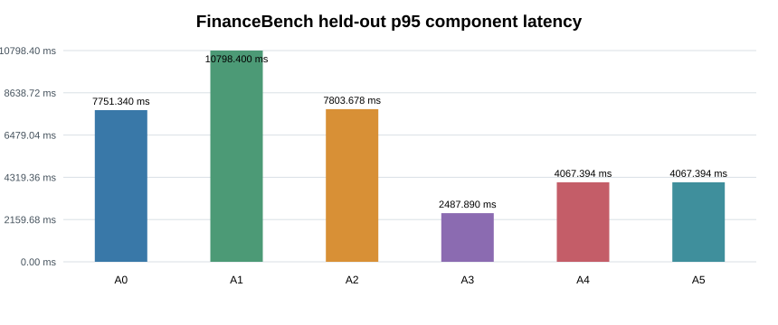
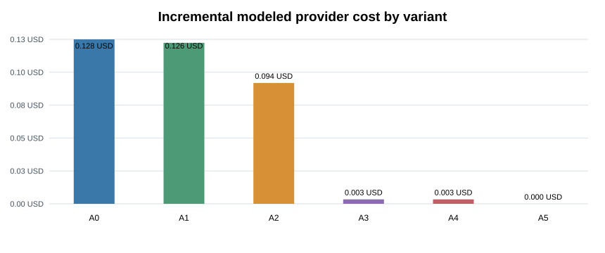

# FinanceBench end-to-end benchmark results

Run date (UTC): `2026-11-07T15:12:30.732259+00:00` 
Cases: **150** (development: 60, held_out: 45, validation: 45) 
Dataset revision: `cc39aeb4afdf33909ee1412188bf89035950c2eb` 
P1 corpus fingerprint: `sha256:9f45dcd8586fe1f52a8b5b48c0dfeeb201498c166f78b01a5a3acd6c00662c48` 
FilingScope source fingerprint: `455dbc363b7e559cf355a3a2182687308edc24d7e791cc843ce33cbc432b0fa3` 
Generator: `openai/gpt-oss-120b`, temperature `0`, prompt `financial-evidence-grounded-v1` (`98e1c18fcdb3e8eb`) 
Provider attempts: **522** total (**461** in the completed run; **61** prior abandoned attempts); current-run usage-based estimate: **$0.35498700**; combined reported cost upper bound: **$0.44151165**; combined conservative preflight maximum: **$0.72049200** (not a provider invoice). Prior-run usage details were not retained; its conservative cost bound of $0.08507790 is carried into the combined estimate.

The answer quality metrics are deterministic text and number comparisons against the FinanceBench gold answers. Text exact match and token F1 measure lexical agreement; they are not semantic grading. Numeric metrics compare extracted value, currency, scale, value kind, and fiscal period. Claim and citation outcomes come from FilingScope’s deterministic verifier. Abstention correctness uses annotated evidence-page coverage as a proxy.

## All-split aggregate

| Metric | A0 | A1 | A2 | A3 | A4 | A5 |
|---|---:|---:|---:|---:|---:|---:|
| Answer coverage | 42.0% | 37.3% | 37.3% | 2.0% | 2.0% | 0.0% |
| Normalized text exact match | 0.0% | 0.0% | 0.0% | 0.0% | 0.0% | 0.0% |
| Answer token F1 | 12.9% | 17.5% | 15.4% | 7.6% | 7.3% | 6.4% |
| Numeric exact accuracy (scored cases) | 0.0% | 0.8% | 0.8% | 0.0% | 0.0% | 0.0% |
| Citation validity | 100.0% | 96.0% | 100.0% | 100.0% | 100.0% | 100.0% |
| Unsupported or contradicted claim rate | 9.7% | 8.8% | 10.8% | 10.0% | 5.3% | 5.3% |
| p50 component latency (ms) | 3121.1 | 4308.1 | 4677.2 | 1652.4 | 1692.2 | 1692.2 |
| p95 component latency (ms) | 7485.7 | 9416.0 | 9198.7 | 2487.9 | 3922.2 | 3922.2 |
| Reranking p95 (ms) | n/a | 0.0 | 313.4 | 313.4 | 313.4 | 313.4 |
| Adaptive gap resolution | n/a | n/a | n/a | n/a | 0.0% | 0.0% |

## Primary held-out results

| Metric | A0 | A1 | A2 | A3 | A4 | A5 |
|---|---:|---:|---:|---:|---:|---:|
| Answer coverage | 44.4% | 35.6% | 40.0% | 0.0% | 0.0% | 0.0% |
| Normalized text exact match | 0.0% | 0.0% | 0.0% | 0.0% | 0.0% | 0.0% |
| Answer token F1 | 11.6% | 16.4% | 17.9% | 7.4% | 7.4% | 7.4% |
| Numeric exact accuracy (scored cases) | 0.0% | 0.0% | 0.0% | 0.0% | 0.0% | 0.0% |
| Citation validity | 100.0% | 85.2% | 100.0% | n/a | n/a | n/a |
| Unsupported or contradicted claim rate | 7.2% | 4.7% | 5.4% | n/a | n/a | n/a |
| p50 component latency (ms) | 3230.2 | 4902.4 | 5179.1 | 1690.8 | 1762.1 | 1762.1 |
| p95 component latency (ms) | 7751.3 | 10798.4 | 7803.7 | 2487.9 | 4067.4 | 4067.4 |
| Reranking p95 (ms) | n/a | 0.0 | 316.3 | 316.3 | 316.3 | 316.3 |
| Adaptive gap resolution | n/a | n/a | n/a | n/a | 0.0% | 0.0% |

The split-specific held-out table is the final result. Development and validation tables below are kept separate for debugging and model/threshold selection; the all-split aggregate is descriptive.

| Split | Variant | Answer coverage | Text token F1 | Numeric exact | Citation validity | p95 ms |
|---|---|---:|---:|---:|---:|---:|
| development | A0 | 43.3% | 13.4% | 0.0% | 100.0% | 7336.8 |
| development | A1 | 45.0% | 18.7% | 0.0% | 100.0% | 7488.2 |
| development | A2 | 35.0% | 14.7% | 0.0% | 100.0% | 8583.1 |
| development | A3 | 3.3% | 6.7% | 0.0% | 100.0% | 1852.1 |
| development | A4 | 3.3% | 6.5% | 0.0% | 100.0% | 3668.7 |
| development | A5 | 0.0% | 6.0% | 0.0% | 100.0% | 3668.7 |
| validation | A0 | 37.8% | 13.6% | 0.0% | 100.0% | 7015.9 |
| validation | A1 | 28.9% | 17.1% | 2.5% | 100.0% | 9478.7 |
| validation | A2 | 37.8% | 13.2% | 2.5% | 100.0% | 10175.2 |
| validation | A3 | 2.2% | 8.8% | 0.0% | 100.0% | 2815.0 |
| validation | A4 | 2.2% | 8.0% | 0.0% | 100.0% | 3849.1 |
| validation | A5 | 0.0% | 5.8% | 0.0% | 100.0% | 3849.1 |

| Metric | A0 | A1 | A2 | A3 | A4 | A5 |
|---|---:|---:|---:|---:|---:|---:|
| Incremental provider calls | 150 | 150 | 150 | 5 | 5 | 0 |
| Incremental modeled provider cost (USD) | $0.12828405 | $0.12559665 | $0.09421350 | $0.00344670 | $0.00344610 | $0 |
| P1 retrieval replay parity | 100.0% | 100.0% | 100.0% | 100.0% | 100.0% | 100.0% |

A5 reuses A4’s generated answer, so it adds verifier latency but no additional provider generation call. P5 replays each frozen P1 A0–A2 retrieval configuration to measure retrieval and reranker stages; the answer evidence itself remains the frozen P1 artifact. The replay match rate shows whether the current replay selected identical chunk IDs. Component totals include query embedding, retrieval, decision/adaptive retrieval, generation, and the active verifier gate.

The raw per-case predictions, aggregate metrics, manifests, prompt fingerprint, and model usage are stored in the ignored local run directory created by `scripts.run_end_to_end_benchmark`; the corpus and generated run artifacts are intentionally not committed.
