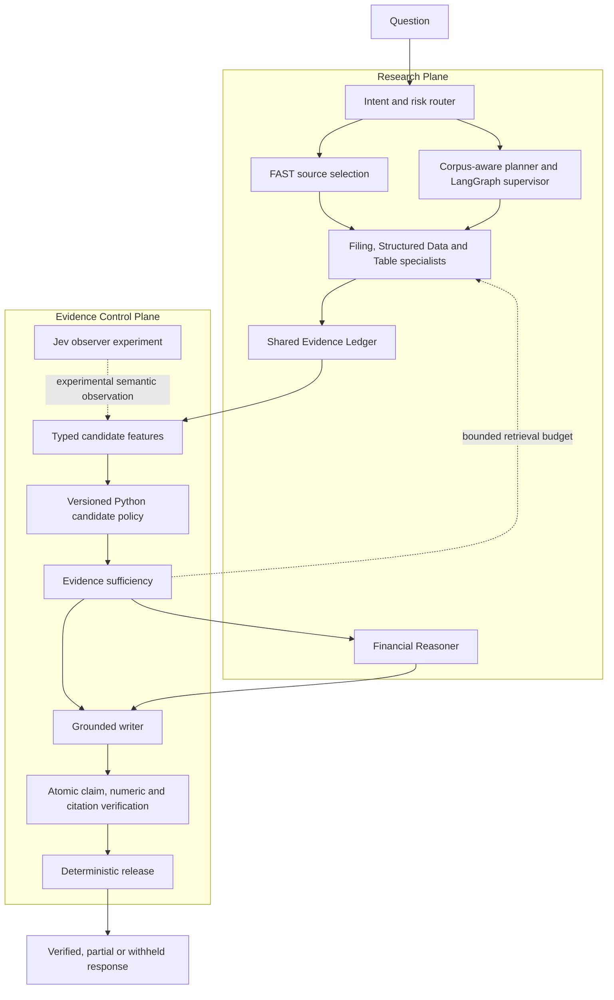
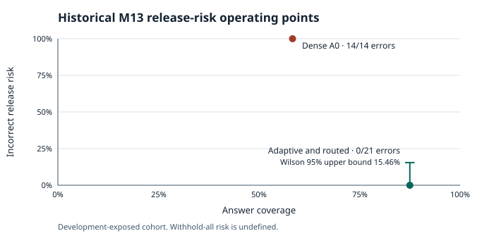

# FilingScope research report

## Objective and evidence

FilingScope tests whether bounded financial research plus deterministic
evidence control improves the quality of released SEC answers.
The strongest results below come from development-exposed cohorts
with frozen source snapshots. The independent result remains
`PROVISIONAL_NOT_INDEPENDENT`. The live TypeSafe Jev comparison uses
18 development-exposed SEC page candidates. The report preserves
each cohort's denominators and scope.

## Implemented architecture

The runtime uses the frozen Dense and statement-rank path with
Company Facts where configured. An optional G3 pilot arm passes one
accession-bound Inline XBRL observation through the same runtime.
Qdrant/BM25 and cross-encoder experiments use separate runtime
retrieval modes.
Jev exercises the existing feature contract in separate offline and
live decision benchmarks.
The Python policy determines candidate acceptance and final release.
[G0 conformance matrix](G0_BASELINE.md#architecture-conformance-and-implementation-inventory).

## Dataset and methods

| Evidence class | Measured data | Interpretation |
| --- | --- | --- |
| Public historical | FinanceBench open sample, 150 queries, and M12's 24-case hard-negative replay | Earlier retrieval and hosted-generation controls on frozen P1. Historical P5 had weak answer coverage. [P5 report](BENCHMARK_RESULTS.md). |
| Development-exposed | M13, Q3/Q5/Q7 and Q8 controls | Paired runtime, source isolation and verifier regression. The repeated use of these cohorts limits inference. |
| SEC 2025 provisional | 17 filings, eight issuers, 32/100/72 auto-XBRL pilot/development/validation lookups | Source-aligned parser and structured lookup tests. The cohort split excludes issuer/accession/fact/revision-family overlap within these groups. [G2 report](G2_SEC_DATA.md). |
| SEC 2025 runtime pilot | 26 PDF-transcribed questions from five filings and four issuers | Identical source-track questions and frozen citation locators. Issuers overlap with earlier cohorts. [Runtime pilot](G2_RUNTIME_REPLAY.md). |
| Public applicability | Pinned FinAgent v1.1.1, 133 questions | 35 cases matched issuer/form, and 10 matched an excerpt in one frozen SEC filing. No full answer benchmark. [Benchmark matrix](G2_SEC_DATA.md#benchmark-compatibility). |
| Independent final | Reviewer-held cohort pending | No independent performance or release-risk estimate. [G6 handoff](G6_EVALUATION_READINESS.md). |

The G1 contract scores eight primary outcomes with raw counts,
separate locator/fact granularities and explicit label applicability.
The synthetic fixture verifies numeric identity, abstention, citation
contributions and atomic support. Strict semantic citation precision
and faithfulness on a new real-filing cohort remain unmeasured.
[Metric definitions](G1_EVALUATION.md#metric-contract).

## Results

| Experiment | Measured outcome |
| --- | --- |
| SEC iXBRL extraction | 20,723 numeric observations, 18,800 identity keys and 10,285 dimensioned observations. Offline cache replay reproduced the manifest byte for byte. |
| Structured parser agreement | 7,087/7,087 unique Company Facts pairs agreed. There were 67 multiple-value groups and 8 missing counterparts. The Apple PDF control agreed on 6/6 cells. |
| Selected 8-K current reports | Three Item 2.02 archives reproduced offline with zero numeric iXBRL observations. Six HTML exhibit cells matched equivalent periodic Company Facts entries. [8-K replay](G2_SEC_CURRENT_REPORTS.md). |
| Mixed SEC cohorts | 204 cases across eight categories and three issuer-disjoint splits. Accession-matched structured lookup agreed on 187/187 numeric cases. On the original questions, document-only confirmed 20/187, Company Facts-only 37/187 and hybrid 37/187. All arms withheld 8/8 missing-unit controls. [Mixed cohorts](G2_SEC_MIXED_COHORTS.md) · [Runtime replay](G2_SEC_MIXED_RUNTIME.md). |
| Explicit reporting intervals | Confirmed answers on the same questions rose to 26/187, 45/187 and 45/187. Both text-enabled arms eliminated five extra prior-year claims. All 122 PDF-pilot outcomes matched. [Interval replay](G3_EXPLICIT_INTERVALS.md). |
| Quarter and YTD by report date | Company Facts-only and hybrid each confirmed 9/26 previously withheld quarter/YTD pairs and 54/187 numeric cases overall. Document-only stayed at 26/187 overall. [Quarter/YTD replay](G3_QUARTER_YTD.md). |
| Consolidated metric mappings | Company Facts-only and hybrid each increased to 26/26 quarter/YTD pairs and 97/187 confirmed numeric cases. Each observed 0/97 incorrect releases and 8/8 correct missing-unit abstentions. Document-only confirmed 26/187. [Metric mapping replay](G3_FINANCIAL_METRIC_MAPPINGS.md). |
| Fiscal year pairs from one 10-K | Company Facts-only and hybrid each confirmed 32/32 annual pairs and 133/187 numeric cases with 0/133 incorrect releases. Document-only confirmed 28/187 with the additional operating cash flow alias. [Fiscal year replay](G3_FISCAL_YEAR_PAIRS.md). |
| Dimensioned iXBRL lookup | Exact typed lookup matched 10/10 PDF cells and rejected 50/50 identity perturbations. [Dimensioned replay](G2_DIMENSIONED_REPLAY.md). |
| SEC 2025 runtime pilot | PDF only grounded 3/23, and Company Facts only and hybrid each grounded 21/23 by frozen locator. All three released consolidated Tesla revenue for an energy business question. |
| Segment reporting scope follow-up | All three tracks withheld the consolidated Tesla value after the guard change. The other 25 case outcomes matched. [Paired report](G3_REPORTING_SCOPE.md). |
| Statement normalization follow-up | PDF-only and hybrid each grounded 22/23 on the same provisional pilot. Company Facts only grounded 21/23 and withheld Walmart's conflicting revenue tags. The two PDF arms resolved Walmart from its income statement. [Paired report](G3_STATEMENT_NORMALIZATION.md). |
| Dimensioned runtime follow-up | The optional Inline XBRL arm grounded 23/23 on the same pilot. It verified Tesla FY2024 energy generation and storage segment revenue with the SEC fact anchor. Hybrid grounded 22/23, and the other 25 outcomes matched. [Paired report](G3_DIMENSIONED_RUNTIME.md). |
| Dense retrieval | M12 Recall@10 56.25%, MRR@10 0.3529 and nDCG@5 0.3757. Q5 page locator micro precision 21/291 and required-slot recall 21/37. |
| Scoped Dense cost | Matching top-10 IDs on 30 paired requests. Rank p50 4.25 → 1.16 ms with cached embeddings. [G3 method](G3_FINANCIAL_RETRIEVAL.md). |
| SEC pilot retrieval | Statement ranking recovered 25/26 frozen evidence targets versus 22/26 for Dense. On four selected questions with author-reviewed alternatives, page Context Precision@10 was 11/36 versus 8/38. Both PDF-only graphs grounded 22/23. [Ranking report](G3_SEC_RANKING.md). |
| SEC pilot claim review | Original and current PDF-only releases had 5/5 and 25/25 supported claims and citations, respectively. Answer-level grounded exactness rose from 4/23 to 22/23 under author review. The original Tesla answer cited a real consolidated figure for the wrong scope. [Claim review](G1_SEC_CLAIM_REVIEW.md). |
| M13 routed | 21/21 grounded exact on answerable cases, 21/24 coverage, 0/21 incorrect releases and 3/3 correct abstentions. |
| Q5/Q6 natural statement | 30/30 grounded exact on answerable cases and 0/30 incorrect releases. 38 tools and 14 embedding calls. |
| Q7 outage | Adaptive retained healthy-source evidence on 5/10 persistent failures and routed LangGraph retained it on 10/10. Both recovered 10/10 one-time failures. |
| SEC 2025 narrative diagnostic | All three source inventories abstained on six reportable segment, product and risk questions. PDF-enabled arms retrieved source support for five cases including author-checked alternative pages. [Narrative track](G2_SEC_NARRATIVE.md). |
| G4 requirement reuse | Instrumented extractor calls 4 → 2 for FAST and 3 → 2 for RESEARCH. Stable historical outputs matched. [G4 method](G4_AGENT_VERIFICATION.md). |
| G4 segment disclosures | Document-only and hybrid each recovered 3/6 narrative answers with all three cited lists author-checked. The frozen wording and page score remained 0/6. All 104 numeric outcomes matched. [Segment replay](G4_SEGMENT_DISCLOSURES.md). |
| Jev mock | Positive and timeout mocks preserved 60/60 expected policy decisions. Negative mock matched 40/60 with 20 ACCEPT → WEAK downgrades and zero hard false accepts. |
| TypeSafe Jev live | All 18 requests returned valid results. Jev judged 10/14 correctly on the shared binary subset, versus Groq 9/14 and deterministic 8/14. Policy changed 0/18 decisions and preserved all five hard rejects. Estimated USD 0.000977. [Live comparison](G5_JEV_LIVE_PROTOCOL.md). |
| Groq structured observer | 16 valid classifications on 18 SEC candidate pages, 11/16 correct support judgments, 5/10 false support judgments and zero changes to policy dispositions. All five hard rejections stayed rejected. [Observer comparison](G5_GROQ_OBSERVER.md). |
| Hosted model controls | Groq GPT-OSS 120B completed both matched arms. A typed numeric replay matched the author's review, with 0/23 exact closed-book and 22/23 exact with context, including 20/23 with all frozen PDF locators. The original shared scorer gave 0/23 and 1/23. [Groq benchmark](G5_GROQ_BASELINES.md) · [Typed replay](G5_GROQ_SCORER_REPLAY.md). |
| Matched local model controls | On the 26-case SEC pilot, Adaptive and routed each grounded 22/23 by frozen locator. Local Qwen 7B scored 0/23 exact closed-book and 1/23 grounded long-context under the shared scorer. Author review found 17/23 long-context answers correct in financial identity and 12/23 fully matched to the frozen locators. [G5 local report](G5_LOCAL_MODEL_BASELINES.md). |

### Accuracy, latency and cost

| M13 arm | Grounded exact | Warm p50/p95 | Mean tools | Provider spend |
| --- | ---: | ---: | ---: | ---: |
| Dense A0 | 0/21 | 63.59/92.86 ms | 1.00 | USD 0 |
| Adaptive with SEC | 21/21 | 15.61/147.04 ms | 1.25 | USD 0 |
| Forced LangGraph | 21/21 | 100.01/301.00 ms | 2.79 | USD 0 |
| Routed LangGraph | 21/21 | 14.06/134.25 ms | 1.33 | USD 0 |

The Dense arm released 14 answers and all 14 failed grounded
exactness. The latter three arms tie on this clean cohort. They
differ in sources and release checks relative to Dense. The
adaptive/forced/routed rows share the replay. Warm CPU samples
exclude setup. The architecture process used about 2.01 GB peak.

### Risk–coverage operating points

| Historical routed threshold | Coverage | Incorrect releases | Descriptive risk |
| --- | ---: | ---: | ---: |
| All rendered | 21/24 | 0/21 | 0% |
| Partial or verified | 21/24 | 0/21 | 0% |
| Verified only | 21/24 | 0/21 | 0% |
| Withhold all | 0/24 | 0/0 | Undefined |

The three release thresholds coincide in this sample. The Wilson
95% upper bound at the released point is 15.46%, so the 5% risk
claim is **INCONCLUSIVE**. The paired adaptive/routed difference
is zero on 21 pairs across eight connected issuer groups. The
grouped bootstrap interval [0, 0] reflects identical observed
outcomes. These disposition points do not support continuous AURC.

## Failure taxonomy

| Failure | Observed evidence and handling |
| --- | --- |
| Wrong source, period, unit or revision | Historical controls withheld unsupported releases. The G3 prior-year expansion now preserves YTD and CY. |
| Rounded versus precise observations | G2 keeps multiple values visible, including Apple's rounded and precise unrecognized-tax-benefit disclosures. |
| Missing taxonomy or transformation | G2 recorded 81 skipped numeric transforms and Arelle schema diagnostics. A schema-complete validation pass remains open. |
| Incomplete data or unavailable filing | Routed LangGraph preserved healthy-source work in the persistent-outage fixture. Both compared workflows withheld the incomplete answer. |
| Unsupported or mis-cited claim | G1 synthetic controls cover wrong basis and a valid narrative cited to the wrong page. G4 preserved existing prompt-injection and release checks. |
| Incomplete applicability | Structured arms withhold remaining numeric requests outside their supported company, metric or period scope, including all 16 cross-company queries in the mixed replay. Document-only still lacks typed dates for the quarter/YTD and annual pairs. [Fiscal year replay](G3_FISCAL_YEAR_PAIRS.md). |

## Reproduce and verify

1. Install the locked CPU profile, prime the tokenizer and restore the
   pinned model and evidence snapshots. [G0 setup](G0_BASELINE.md#reproduce).
2. Run the offline suite, Ruff, focused mypy and the G1 metric fixtures.
   [G1 commands](G1_EVALUATION.md#reproduce).
3. Install the optional Arelle profile and replay the frozen SEC manifest,
   parser comparison, cohort split and public applicability audit.
   [G2 commands](G2_SEC_DATA.md#reproduction-and-decision).
4. Replay retrieval and specialist controls with the same P1/SEC snapshots.
   [G3 report](G3_FINANCIAL_RETRIEVAL.md) and [G4 report](G4_AGENT_VERIFICATION.md).
5. Run the local observer and hosted prompt dry runs, then generate the
   historical readiness report and label-free checklist.
   [G5 commands](G5_BASELINE_EXPERIMENT.md#verification-and-decision) and
   [G6 report](G6_EVALUATION_READINESS.md).

## Portfolio statements

- Built a bounded LangGraph SEC research workflow with a shared
  evidence ledger and deterministic numeric, citation and release
  checks. Reproduced 21/21 grounded answers on 21 answerable M13
  development-exposed cases.
- Built a content-addressed SEC Inline XBRL pipeline that reproduced
  20,723 numeric observations from 17 filings offline and verified
  7,087 identity-matched values against SEC Company Facts.
- Reduced scoped Dense rank p50 from 4.25 ms to 1.16 ms while
  preserving all top-10 IDs on 30 paired historical requests.

## Status

**KEEP** the measured backend changes, reproducible setup and
deterministic authority. **REJECT** promoting either live observer on
the measured candidate cohort. **DEFER** independent claims until a
reviewer bundle is available. Remaining research gaps include adjudicated mixed
cohorts and full Inline XBRL taxonomy validation. The Transformers
4.57.6 compatibility debt remains documented in G0.

The latest offline verification passed 557 tests on Windows with
three corpus skips and 556 tests with four skips on Linux WSL with
the Inline XBRL extra. Ruff and focused mypy passed. GitHub Actions
has no run for these local commits.
